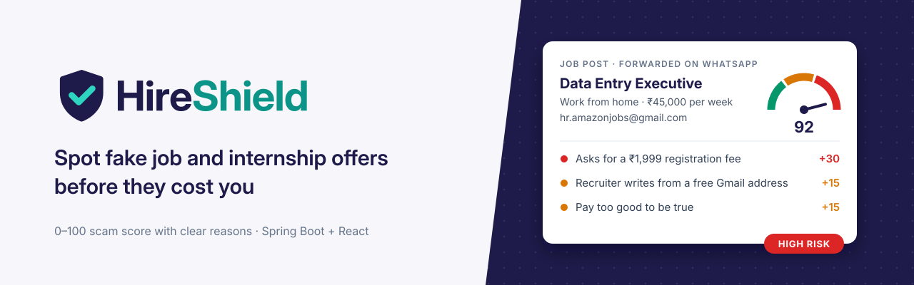
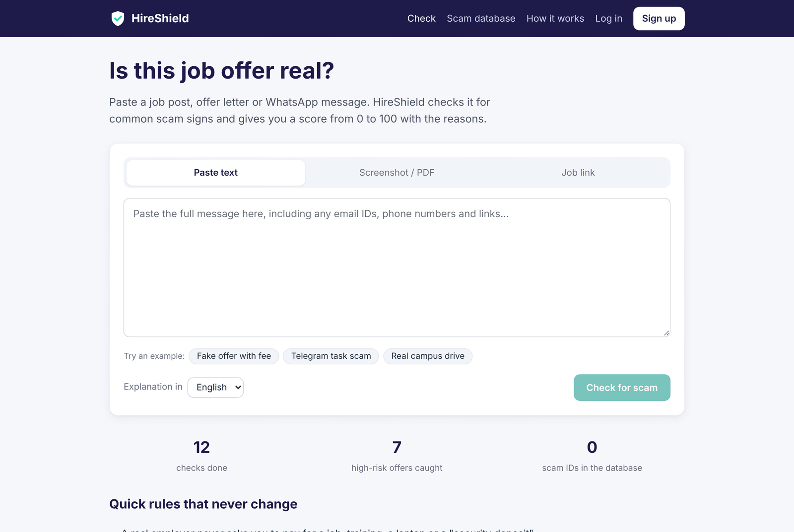
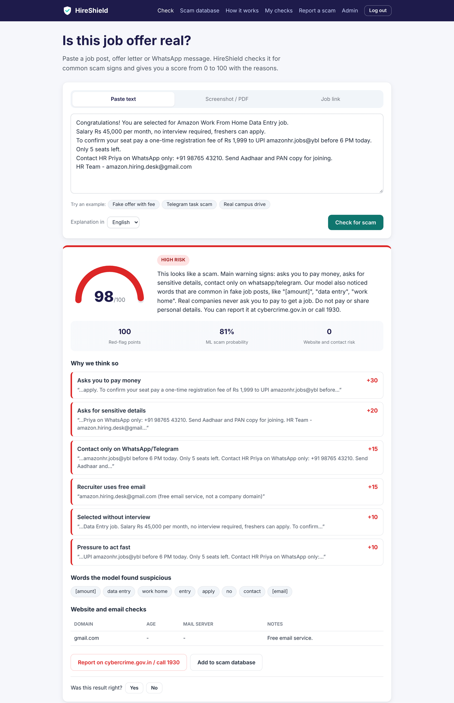
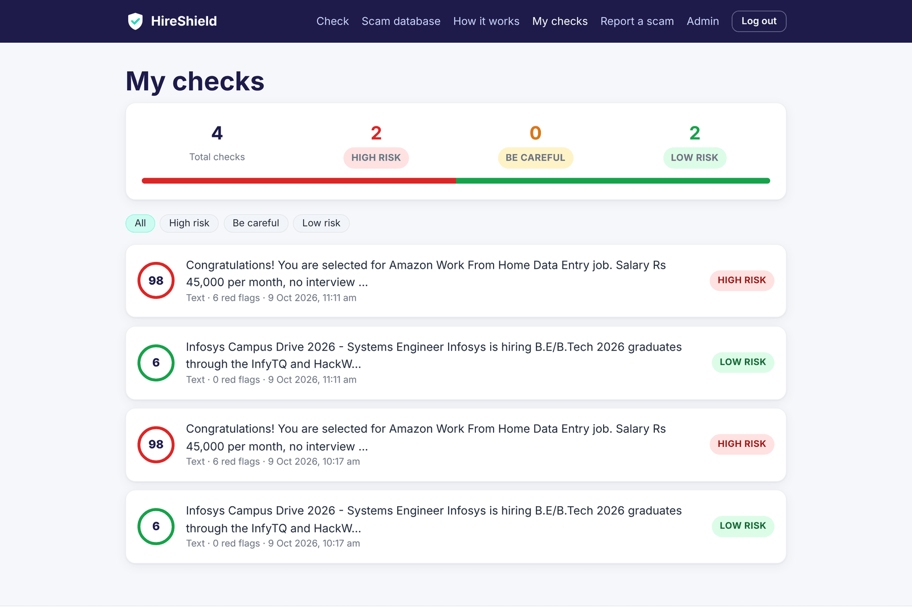
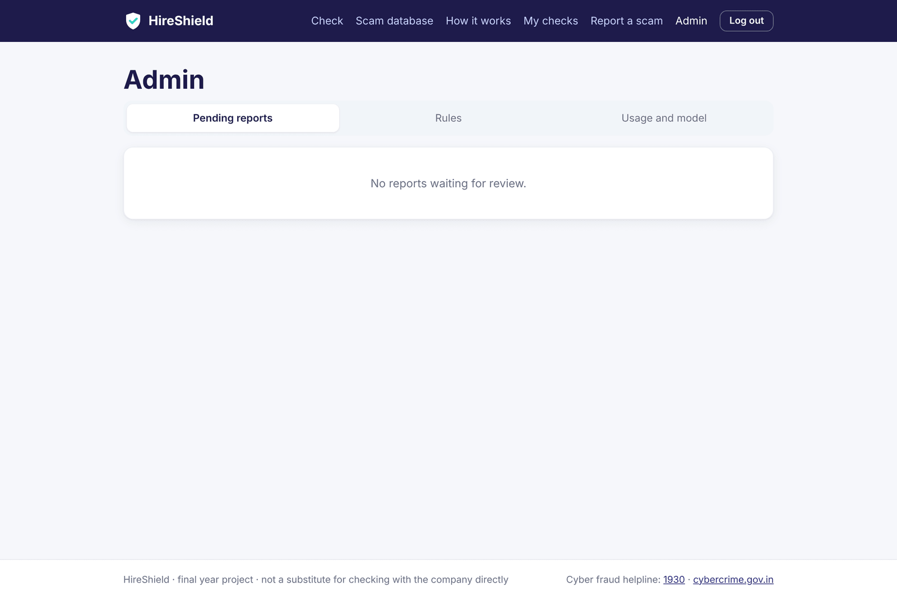
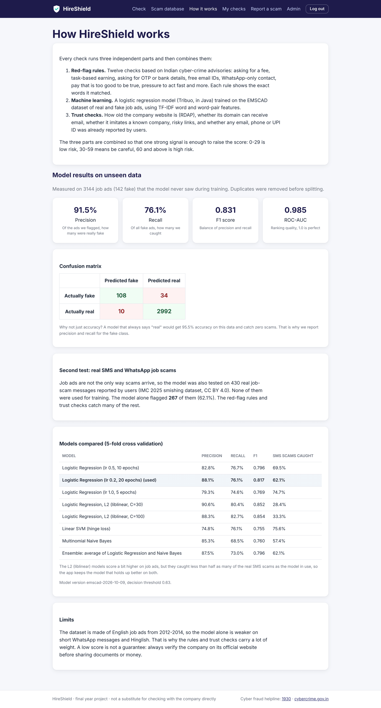
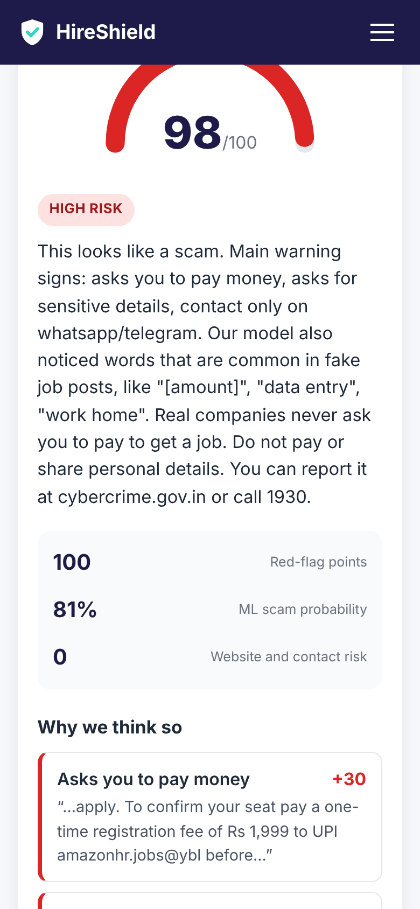
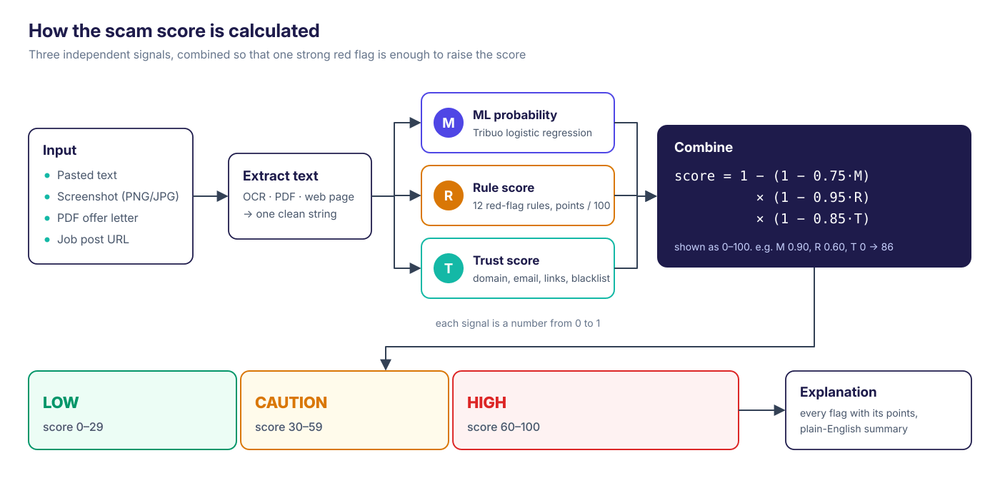
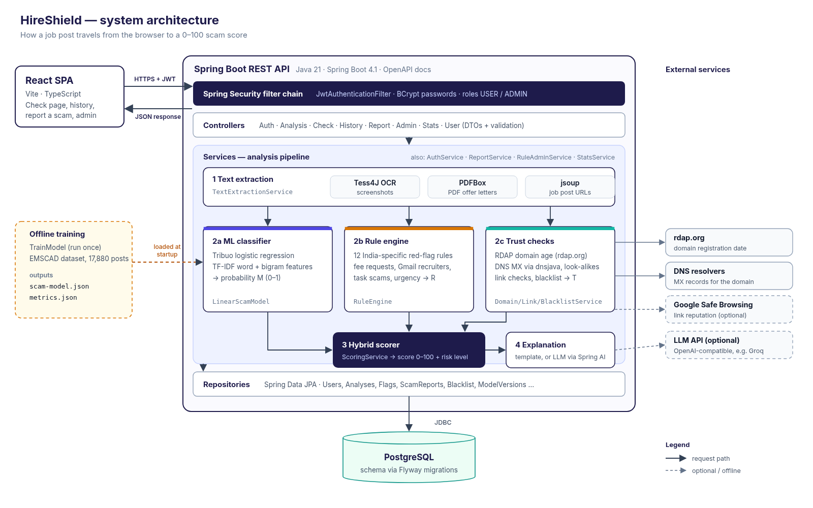
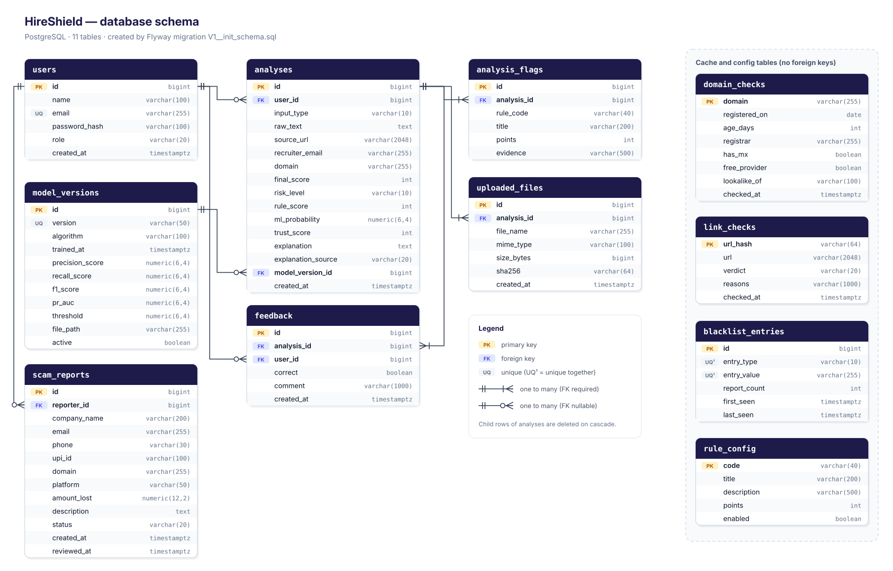

<p align="center">
  
</p>

<p align="center">
  <a href="https://github.com/username1puni/hireshield/actions/workflows/ci.yml"></a>
  
  
  
  
  <a href="LICENSE"></a>
</p>

<p align="center">
  <b><a href="https://hireshield.sites.tab.bot/">Live demo</a></b> &middot;
  <a href="https://hireshield.sites.tab.bot/swagger-ui.html">API docs (Swagger)</a> &middot;
  <a href="docs/model-experiments.md">Model experiments</a>
</p>

# HireShield

Fake job and internship offers are one of the most common online frauds in India. They promise easy
work-from-home jobs or "direct selection" at a big company, then ask for a registration fee, a laptop
deposit or your bank OTP. Students and freshers are the main targets.

HireShield lets anyone paste a job message, upload a screenshot or PDF offer letter, or enter a job
link, and get a **0-100 scam score with the reasons behind it**. Every point in the score can be traced
to a rule that fired, words the ML model found suspicious, or a problem with the company's website or
email domain.

## Features

- **Check anything**: pasted text (WhatsApp, SMS, email), screenshots (OCR with Tesseract), PDF offer
  letters and job page URLs.
- **12 red-flag rules** based on Indian cyber crime advisories: fee requests, task-based earning,
  OTP / Aadhaar / bank detail requests, fake government jobs, free email recruiters, WhatsApp-only
  contact, unrealistic pay, pressure tactics and more. Each rule shows the exact text it matched.
- **Machine learning model** written in Java with Tribuo, trained on the EMSCAD fake job postings
  dataset (TF-IDF word and word-pair features, logistic regression).
- **Trust checks**: domain age through RDAP, MX records, look-alike domains (`infosys-careers.co`),
  risky links and identifiers already reported by other users.
- **Clear explanation** for every result, with a "Report to cybercrime.gov.in / call 1930" tip on high
  risk results. An LLM can be plugged in for friendlier explanations (optional, off by default).
- **Accounts with JWT**: history of past checks, feedback ("was this correct?"), and a personal dashboard.
- **Community scam reports**: users report scam emails, phone numbers and UPI IDs; an admin reviews
  them and approved ones go into a blacklist that raises future scores.
- **Admin panel**: review reports, turn rules on and off, change rule points, see model metrics.
- **Model page** that shows the real test results, the confusion matrix and how models were compared.

## Screenshots

| Check a message | High risk result |
| --- | --- |
|  |  |

| History | Admin panel |
| --- | --- |
|  |  |

| Model results | On a phone |
| --- | --- |
|  |  |

## How the score works

<p align="center"></p>

Three independent signals are computed and then combined as independent pieces of evidence:

```
score = 1 - (1 - 0.75 * M) * (1 - 0.95 * R) * (1 - 0.85 * T)
```

`M` is the ML probability, `R` the rule score and `T` the trust score (both scaled to 0-1). One strong
signal is enough to raise the score, and a missing signal (for example, no website in the message)
does not pull it down. 0-29 is **low**, 30-59 is **be careful**, 60-100 is **high risk**.

## Architecture

<p align="center"></p>

- **Frontend**: React 19 + TypeScript + Vite single page app, served by Spring Boot in production.
- **Backend**: Spring Boot 4.1 on Java 21, layered as controller -> service -> repository, with DTOs and
  Bean Validation on every request, a global exception handler and OpenAPI docs.
- **Security**: Spring Security with stateless JWT (jjwt), BCrypt password hashes, role based access
  for admin endpoints, per-IP rate limiting on the public check.
- **Database**: PostgreSQL with Flyway migrations (H2 in PostgreSQL mode for tests).
- **Text extraction**: Tess4J (Tesseract OCR) for images, Apache PDFBox for PDFs, jsoup for web pages.
- **ML**: Tribuo (Oracle's Java ML library). Training runs offline; the app serves the exported weights.

### Database

<p align="center"></p>

## Model results

The ML model was trained and tested on EMSCAD (17,880 job ads, 866 fake). The protocol is kept strict
so the numbers can be trusted:

1. 2,163 duplicate ads were removed first, otherwise copies of the same ad end up in both training and
   test data and the score looks better than it is.
2. A stratified 20% test set (3,144 ads, 142 fake) was put aside and not touched until the end.
3. Models and the decision threshold were chosen with 5-fold cross validation on the other 80%.

| Held-out EMSCAD test (3,144 ads) | Value |
| --- | --- |
| Precision | 91.5% |
| Recall | 76.1% (108 of 142 fake ads caught) |
| F1 | 0.831 |
| ROC-AUC | 0.985 |
| False alarms | 10 of 3,002 real ads |

Accuracy is 98.6%, but that number on its own means little: a model that always answers "real" gets
95.5% on this data and catches nothing. That is why precision and recall on the fake class are reported.

**Second test on real SMS / WhatsApp scams.** Job ads are not the only way scams arrive, so the system
was also tested on 430 real job-scam text messages from the IMC 2025 smishing dataset (never used for
training). With the full system (rules + ML + trust checks), **83% of them got a warning** (score 30+) and about half were rated high risk; the ML model alone caught 62%. On the 3,002 real ads of the main test set, the full system raised a high-risk alarm on only 5 (precision 95.4% at the high-risk level).

The full comparison, including models that were tried and not used, is in
[docs/model-experiments.md](docs/model-experiments.md).

## Tech stack

| Area | Tools |
| --- | --- |
| Backend | Java 21, Spring Boot 4.1 (Web MVC, Data JPA, Security, Validation, Actuator), Lombok |
| Database | PostgreSQL 16, Flyway, H2 for tests |
| Auth | Spring Security, JWT (jjwt 0.13), BCrypt |
| ML | Tribuo 4.3 (logistic regression, liblinear, naive Bayes), custom TF-IDF |
| Documents | Tess4J 5.7 (Tesseract OCR), Apache PDFBox, jsoup |
| Network checks | RDAP (rdap.org), dnsjava, Google Safe Browsing (optional) |
| Explanations | Spring AI with any OpenAI-compatible API (optional) |
| Frontend | React 19, TypeScript, Vite, React Router, Vitest + Testing Library |
| DevOps | Docker (multi-stage), docker compose, GitHub Actions, Maven wrapper, JaCoCo |
| Testing | JUnit 5, Mockito, AssertJ, Spring MockMvc, Testcontainers |

## Run it locally

### With Docker (easiest)

```bash
git clone https://github.com/username1puni/hireshield.git
cd hireshield
cp .env.example .env        # then set DB_PASSWORD, JWT_SECRET and the admin login
docker compose up --build
```

Open http://localhost:8080. Swagger UI is at http://localhost:8080/swagger-ui.html.

### Without Docker

You need Java 21, Node 22, PostgreSQL 16 and Tesseract (`sudo apt install tesseract-ocr libtesseract-dev`).

```bash
# database
createdb hireshield

# backend (http://localhost:8080)
cd backend
export DB_URL=jdbc:postgresql://localhost:5432/hireshield DB_USERNAME=postgres DB_PASSWORD=postgres
export JWT_SECRET=$(openssl rand -base64 48) ADMIN_EMAIL=admin@example.com ADMIN_PASSWORD=change-me
./mvnw spring-boot:run

# frontend dev server (http://localhost:5173), in another terminal
cd frontend
npm install
npm run dev
```

### Retrain the model

Download `fake_job_postings.csv` (EMSCAD) from Kaggle into `data/`, then:

```bash
cd backend
./mvnw -Ptrain compile exec:java -Dexec.args="--data ../data/fake_job_postings.csv --out src/main/resources/model"
```

Add `--scam-test file.csv` to also score a scam-only second test set (columns `text,label,source`).
To measure the whole pipeline (rules + ML + trust) instead of the model alone:

```bash
./mvnw test -Dtest=HybridBenchmarkTest -Dbenchmark=true \
    -Dbenchmark.data=../data/fake_job_postings.csv -Dbenchmark.sms=../data/imc25_smishing.csv
```

## API

Interactive docs: [Swagger UI](https://hireshield.sites.tab.bot/swagger-ui.html) (OpenAPI JSON at `/v3/api-docs`).

| Method | Endpoint | Auth | What it does |
| --- | --- | --- | --- |
| POST | `/api/auth/register` | - | Create an account |
| POST | `/api/auth/login` | - | Log in, returns a JWT |
| GET | `/api/users/me`, `/api/users/me/stats` | user | Profile and personal stats |
| POST | `/api/analyze/text` | optional | Check pasted text |
| POST | `/api/analyze/file` | optional | Check a screenshot or PDF (multipart) |
| POST | `/api/analyze/url` | optional | Check a job page link |
| GET | `/api/analyses`, `/api/analyses/{id}` | user | History (filter by risk, paged) and details |
| DELETE | `/api/analyses/{id}` | user | Delete a check |
| POST | `/api/analyses/{id}/feedback` | user | "Was this correct?" |
| GET | `/api/check/domain`, `/api/check/email` | - | Domain / recruiter email check |
| POST | `/api/check/link` | - | Link safety check |
| POST | `/api/reports` | user | Report a scam (email, phone, UPI ID, domain) |
| GET | `/api/reports/search` | - | Search the community scam database |
| GET | `/api/stats/public`, `/api/model/metrics` | - | Public numbers and model metrics |
| GET, PATCH | `/api/admin/reports`, `/api/admin/reports/{id}` | admin | Review scam reports |
| GET, PUT | `/api/admin/rules` | admin | View and tune the red-flag rules |
| GET | `/api/admin/metrics` | admin | Model and usage metrics |

## Project structure

```
hireshield/
├── backend/                     Spring Boot API
│   └── src/main/java/com/hireshield/
│       ├── controller/          REST endpoints
│       ├── service/             analysis, scoring, domain/link checks, OCR, reports
│       ├── rules/               the 12 red-flag rules and the rule engine
│       ├── ml/                  TF-IDF, served model; ml/training = offline training job
│       ├── security/            JWT filter and service
│       ├── entity/ repository/ dto/ config/ exception/ util/
│   └── src/main/resources/
│       ├── db/migration/        Flyway SQL
│       └── model/               trained weights, vocabulary and metrics.json
├── frontend/                    React + TypeScript (Vite)
├── docs/                        diagrams, screenshots, model experiments
├── Dockerfile, docker-compose.yml
└── .github/workflows/ci.yml
```

## Testing

```bash
cd backend && ./mvnw verify     # unit + integration tests, Testcontainers PostgreSQL test, JaCoCo report
cd frontend && npm test         # Vitest
```

The backend has 98 tests: unit tests for every rule, the scorer, JWT, TF-IDF and the metric
calculations, and integration tests on the full Spring context (register/login, 401/403 handling,
history isolation between users, PDF upload, the report -> admin approval -> blacklist flow). A
Testcontainers test runs every Flyway migration against a real PostgreSQL. GitHub Actions runs all of
it, the frontend tests and a Docker build on every push.

## Limitations

- EMSCAD is English job ads from 2012-2014. The model alone is weaker on short messages and Hinglish,
  which is why rules and trust checks carry a lot of weight.
- Rules are keyword based, so a scammer who words things carefully can avoid them.
- Domain age needs the RDAP service to answer; some country domains do not publish dates.
- A low score is not a guarantee. Always confirm an offer on the company's official careers page.

## Datasets and credits

- **EMSCAD**, Employment Scam Aegean Dataset (University of the Aegean), via Kaggle "Real or Fake Job
  Posting Prediction" (CC0). Used for training and the main test.
- **IMC 2025 smishing dataset**: Agarwal, Papasavva, Suarez-Tangil and Vasek, *Fishing for Smishing*,
  ACM IMC 2025, [github.com/reportsmishing/Smishing-Dataset-IMC25](https://github.com/reportsmishing/Smishing-Dataset-IMC25),
  CC BY 4.0. 430 job-scam messages were selected with a keyword filter and used only as a test set.
- Red-flag rules follow public advisories from the Indian Cyber Crime Coordination Centre (I4C),
  cybercrime.gov.in and the 1930 helpline.

## License

[MIT](LICENSE) &copy; 2026 S Manohara
